   <p align="center">
     
   </p>

# Spotify Genre Sorter

A command-line tool that sorts your Spotify **Liked Songs** by genre and, optionally, creates one private playlist per genre.

If you have thousands of liked songs, Spotify gives you no way to filter them by genre. This tool does it in a single command.

## Features

- Fetches your entire Liked Songs library through the Spotify Web API, with pagination
- Looks up artist genres on Last.fm and groups songs into about 20 broad buckets (Rock, Pop, Rap & Hip Hop, Electronic, plus Brazilian genres such as Sertanejo, MPB and Brazilian Funk)
- Exports the full classification to a CSV file
- Creates private playlists per genre, with a configurable minimum size and name prefix
- Caches Liked Songs and artist tags locally, so re-runs are fast and use almost no API quota

## How it works

```
Spotify Liked Songs ──► artists ──► Last.fm top tags ──► genre buckets ──► CSV / Spotify playlists
                                                         (keyword matching
                                                          + majority vote)
```

1. **Genres come from the artist.** Spotify has no per-track genres, and in practice Development Mode apps receive an empty `genres` list for every artist. So the tool uses each artist's top tags from the [Last.fm API](https://www.last.fm/api) instead.
2. **Tags are granular and noisy** (e.g. `alternative rock`, `funk carioca`, `seen live`). Each tag is matched against keyword lists, as whole words, and mapped to a broad bucket. Tags that match nothing are ignored.
3. **An artist's tags can point to different buckets.** The bucket with the most matches wins, and ties go to the more specific bucket. For example, `["k-pop", "pop"]` becomes **K-pop & J-pop**, and `["funk carioca", "funk"]` becomes **Brazilian Funk**.
4. **Only the artists that are needed get looked up.** A song is classified by its first credited artist. Featured artists are looked up only when the main artist has no useful tags.
5. **There are fallbacks for missing data.** If Last.fm doesn't know an artist, the tool retries without accents (`RÜFÜS DU SOL` → `Rufus Du Sol`). If no artist on a song has useful tags, it uses the song's own Last.fm tags. Failed requests are not cached, so they are retried on the next run.

### Working within Spotify's API limits

Spotify restricted Development Mode apps in February 2026, and they now have a request quota. A quota hit can lock the app out for about 24 hours. The tool is designed around this:

- **Spotify is used only where it's needed:** reading Liked Songs (one request per 50 songs) and creating playlists. A library of 2,000 songs costs about 40 requests to read.
- **Liked Songs are cached locally.** Re-running the tool to tweak the buckets costs zero Spotify requests. Use `--refresh` to download them again.
- **Rate limits are handled:** short ones (`429` with a short `Retry-After`) are waited out. If the daily quota is reached, the tool stops with a clear message instead of hanging for hours.
- **The current endpoints are used.** Playlists are created with `POST /me/playlists` and filled with `POST /playlists/{id}/items`, which replace the removed `/users/{id}/playlists` and `/playlists/{id}/tracks`.

## Tech stack

- Python 3.9+
- [Spotipy](https://spotipy.readthedocs.io/) for the Spotify Web API and OAuth 2.0 (Authorization Code flow)
- [Requests](https://requests.readthedocs.io/) for the Last.fm API
- python-dotenv for configuration

## Setup

You need a **Spotify Premium** account, which Spotify requires for Development Mode apps, and a free **Last.fm API key**.

1. Create an app at the [Spotify Developer Dashboard](https://developer.spotify.com/dashboard):
   - Redirect URI: `http://127.0.0.1:8888/callback`
   - API: **Web API**
2. Get a Last.fm API key at [last.fm/api/account/create](https://www.last.fm/api/account/create).
3. Clone the repository and install the dependencies:
   ```bash
   git clone https://github.com/BeBarguil/spotify-genre-sorter.git
   cd spotify-genre-sorter
   python3 -m venv .venv
   source .venv/bin/activate
   pip install -r requirements.txt
   ```
4. Copy `.env.example` to `.env` and fill in your keys:
   ```bash
   cp .env.example .env
   ```

## Usage

```bash
python genre_sorter.py                         # print a summary and export songs_by_genre.csv
python genre_sorter.py --create-playlists      # also create one private playlist per genre
python genre_sorter.py --create-playlists --min-songs 10 --prefix "🎧 "
```

The first run opens your browser so you can authorize the app.

| Option | Default | Description |
|---|---|---|
| `--create-playlists` | off | Create a private playlist for each genre bucket |
| `--min-songs` | `5` | Skip buckets with fewer songs than this |
| `--prefix` | `Liked · ` | Text added before each playlist name |
| `--refresh` | off | Download Liked Songs again instead of using the local copy |

## Customizing genres

The buckets are defined in the `BUCKETS` list in [`genre_sorter.py`](genre_sorter.py). Each entry is a bucket name followed by the keywords that map to it:

```python
("Rock", ["rock", "grunge", "shoegaze", "post-punk"]),
```

## Limitations

- Genre comes from the artist, so an artist who crosses genres puts all of their songs in the same bucket.
- Last.fm tags are user-generated. Little-known artists may have no tags and end up in **Unknown genre**. On a real library of about 1,250 songs, roughly 87% were classified.
- Running the tool again creates new playlists. It does not update existing ones.

## Roadmap

- [ ] Update existing playlists instead of creating duplicates
- [ ] Unit tests for the genre classification logic
- [ ] Weight tags by their Last.fm popularity instead of counting them equally

## License

MIT
